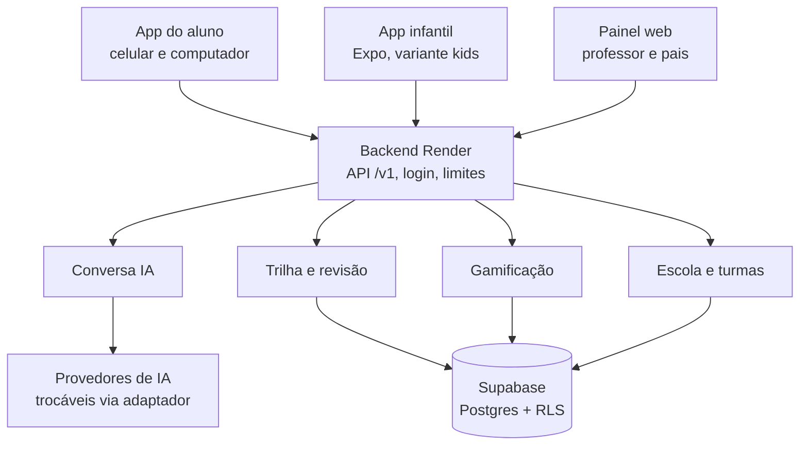

# Arquitetura

Atualizado em 15/10/2026

## Onde está cada parte no código

| Parte | Pasta | Responsabilidade |
| --- | --- | --- |
| Contratos | `packages/contracts` | Formato de toda requisição/resposta (Zod + TypeScript) |
| Cliente da API | `packages/api-client` | Usado pelos apps e painel; valida toda resposta |
| Revisão espaçada | `packages/srs` | Half-life regression simplificado, funções puras |
| Feature flags | `packages/flags` | Turma > escola > global > padrão |
| IA | `packages/ai` | Adaptador de provedores, prompts versionados, filtro de conteúdo |
| Backend | `apps/api` | Fastify, rotas `/v1`, autenticação, limites de custo, auditoria |
| Apps | `apps/mobile` | Um código: app do aluno e infantil (iPhone/Android) + app do aluno no computador (navegador) |
| Painel | `apps/web` | Next.js, painel do professor |
| Banco | `supabase/migrations` | Esquema + RLS; testes em `supabase/tests` |

## 1. Robustez

- Módulos isolados que se falam por contratos tipados. Se a gamificação falhar, a aula continua.
- Monorepo: mudança no contrato que quebre o painel aparece na compilação, não no celular do aluno.
- API versionada (`/v1`; uma `/v2` é registrada ao lado, sem tocar na `/v1`).
- IA atrás de adaptador: trocar de provedor muda `AI_PROVIDER`, não o app.
- Se a IA cair ou responder lixo, o aluno recebe uma fala segura (testado).

## 2. Segurança (atenção a menores)

- RLS em todas as tabelas, isolamento por `school_id`. Testado: o Conceito não vê o COC.
- Perfis: aluno, responsável, professor, coordenação, admin. Responsável só vê o filho **com consentimento** registrado.
- Apps só leem; escrita só pelo backend (`service_role`). Testado: aluno não consegue se dar XP nem virar admin.
- Chaves de IA e `service_role` só no servidor. Sessão no app guardada no cofre do sistema.
- Filtro de conteúdo na entrada e saída da IA, mais rígido no infantil; dados pessoais removidos antes de ir ao provedor.
- Auditoria somente-acréscimo (nem o backend apaga).
- Limite diário de minutos por aluno (controle de custo e de uso).

## 3. Mudar sem destruir

Veja `MUDANCAS-SEGURAS.md`.
